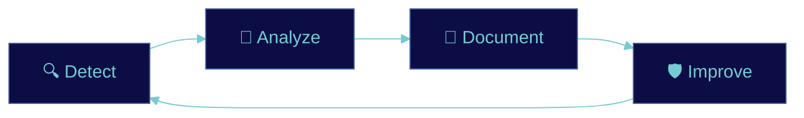

<div align="center">


<a href="https://github.com/[TU_USUARIO]">
  
</a>

<br>


<br><br>

<a href="[TU_LINKEDIN]"></a>
<a href="mailto:[TU_CORREO]"></a>

</div>


## `> whoami`

```bash
$ whoami
[tu-usuario]

$ cat profile.txt
role      : Cybersecurity Technology student
focus     : Defensive security · Blue Team · SOC
learning  : SIEM, network security, Windows/Linux, Python
goal      : SOC / Blue Team analyst
philosophy: "I only claim what I can show."
```

I'm building my foundations from the ground up and documenting every step in public. This profile is my **learning log**: labs, notes and projects, each one with evidence and an honest status.


## `> security_lifecycle`




## `> areas_of_interest`

<table>
<tr>
<td width="33%" valign="top">

**🛡️ Defense**
- Blue Team · SOC
- SIEM & threat detection
- Incident analysis

</td>
<td width="33%" valign="top">

**🌐 Infrastructure**
- Network security
- Windows / Linux hardening
- Cloud security

</td>
<td width="33%" valign="top">

**🤖 Automation**
- Python scripting
- AI for cybersecurity
- Ethical pentesting *(authorized labs only)*

</td>
</tr>
</table>


## `> tech_stack`

> ✅ hands-on · 🔄 learning · 📅 planned. Edit each line honestly.

<div align="center">


<br><br>


</div>

| Category | Tools | Status |
|---|---|---|
| Monitoring & SIEM | Wazuh, Sysmon, Sysinternals | 🔄 |
| Networking & Firewalls | FortiGate, GNS3 | 🔄 |
| Operating Systems | Linux, Windows Server | 🔄 |
| Virtualization | VMware | 🔄 |
| Programming | Python | 🔄 |


## `> featured_projects`

<table>
<tr>
<td width="50%" valign="top">

### 🛡️ [nombre-repo-1](URL)
[1 línea: qué hiciste y qué lograste]


</td>
<td width="50%" valign="top">

### 🌐 [nombre-repo-2](URL)
[1 línea: qué hiciste y qué lograste]


</td>
</tr>
</table>


## `> certifications_and_training`

| Name | Provider | Status |
|---|---|---|
| [Nombre real] | [Entidad] | ✅ Completed · [año] |
| [Nombre real] | [Entidad] | 🔄 In progress |
| [Nombre real] | [Entidad] | 📅 Planned |

> Certifications support my learning. My real evidence is in the labs.

<details>
<summary><b>🧪 Hands-on labs (click to expand)</b></summary>
<br>

- 🔄 [Lab 1: ej. Wazuh SIEM on a VMware lab]
- 🔄 [Lab 2: ej. Sysmon + Sysinternals telemetry]
- 📅 [Lab 3: ej. FortiGate policies in GNS3]

</details>

<details>
<summary><b>🎯 Learning goals (click to expand)</b></summary>
<br>

- [ ] Build a documented SIEM home lab with detection use cases
- [ ] Write my first lab incident-response report
- [ ] Automate log analysis with Python
- [ ] [Certificación objetivo]

</details>

<details>
<summary><b>📂 Repository map (click to expand)</b></summary>
<br>

| Category | Repos |
|---|---|
| 🔐 Cybersecurity Fundamentals | [enlaces] |
| 🌐 Networking & Infrastructure | [enlaces] |
| 🛡️ Blue Team & SIEM | [enlaces] |
| 🐍 Python & AI for Cybersecurity | [enlaces] |
| 📚 Study Notes & Reports | [enlaces] |

</details>


## `> github_activity`

<div align="center">


<br>


<br>


<br>


</div>

> Si algún widget sale roto, bórralo. Es normal que estos servicios gratuitos fallen a veces.


## `> contact`

<div align="center">

**Let's connect and learn together.**

<a href="[TU_LINKEDIN]"></a>
<a href="mailto:[TU_CORREO]"></a>


</div>
